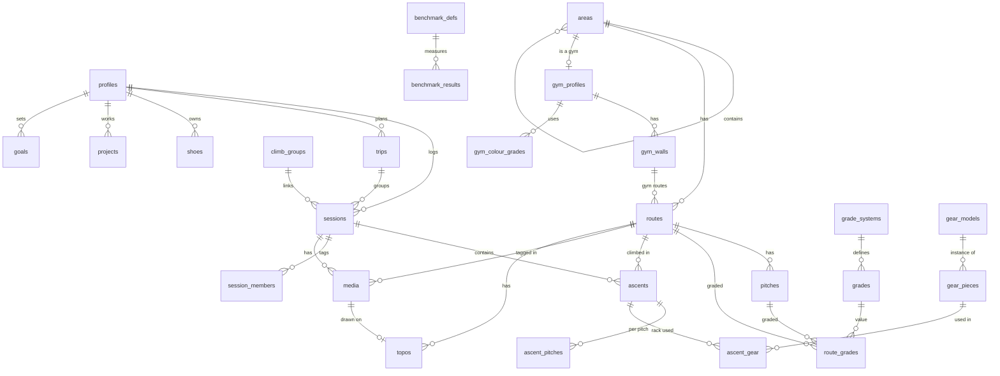

# Pitchbook data schema

This is the data model for the app's local SQLite database (drift) and the Supabase Postgres database. Both use the same tables and column names, so PowerSync can sync them and a future web app can use the same API.

Supported climbing: sport, trad, bouldering, multipitch, alpine, ice, mixed, aid and deep water solo, outdoors and in the gym.

## Conventions

| Rule | Detail |
|---|---|
| IDs | `id` is a UUIDv7, generated on the device. Works offline and sorts by creation time |
| Ownership | `owner_id` on every user-owned row. Only the owner may change it |
| Timestamps | `created_at`, `updated_at` in UTC. `deleted_at` for soft deletes; rows are never hard-deleted by clients |
| Local dates | Sessions store `local_date` (`YYYY-MM-DD`) and `tz` (IANA name, for example `Europe/Oslo`) so a session abroad lands on the right day |
| Units | Always SI: metres (`_m`), kilograms (`_kg`), °C (`_c`), seconds (`_s`), millimetres only where the domain uses them (`edge_mm`, `diameter_mm`). Converted only for display |
| Enumerations | Stored as text keys with a check constraint, not Postgres enum types, so values can be added with a simple migration. Keys are stable identifiers such as `hold.crimp`; display text comes from translations |
| Visibility | `visibility` is `public`, `friends` or `private` wherever a row can be seen by others |
| Shared rows | Areas, routes, grade systems, attribute definitions and the gear catalog are shared. Clients never update shared rows directly; they go through suggested edits or server functions |
| Year-month dates | Gear and shoe dates where only the month is known use `YYYY-MM` text |
| Types across databases | UUID: `uuid` in Postgres, text in SQLite. JSON: `jsonb` / text. Booleans: `boolean` / integer. Location: `latitude`, `longitude` columns in both, plus a PostGIS `geography` column on the server for nearby searches |
| Migrations | Never edit a merged migration. Add a new one |

## Overview

## 1. Users and settings

**profiles**: one per user, `id` equals the Supabase Auth user ID.

| Column | Type | Notes |
|---|---|---|
| id | uuid | Before sign-in, a local ID that is replaced on first sign-in |
| display_name | text | |
| avatar_media_id | uuid → media | Cropped square picture |
| home_area_id | uuid → areas | |
| default_visibility | text | Default for new sessions |
| rack_visibility | text | Who can see your rack |
| grade_prefs | jsonb | Display system per grade type, for example `{"free_route": "nor", "boulder": "font", "ice": "wi"}` |
| theme | text | `rope` or `forest` |
| quiet_hours | jsonb | Start and end for notifications |
| created_at, updated_at, deleted_at | timestamptz | |

**device_tokens** (server only): `id`, `owner_id`, `platform` (`ios`, `android`), `token`, `last_seen_at`.

## 2. Places

**areas**: one tree for every place, from country down to a single boulder block or gym.

| Column | Type | Notes |
|---|---|---|
| id | uuid | |
| parent_id | uuid → areas | Null for top-level countries |
| type | text | `country`, `region`, `area`, `crag`, `sector`, `wall`, `boulder_block`, `gym` |
| name | text | |
| country_code | text | ISO 3166-1 alpha-2, set on every row for fast filtering |
| latitude, longitude | double | |
| altitude_m | integer | Important for alpine and ice |
| rock_type | text | `rock.granite`, `rock.limestone` and so on. Children inherit when null |
| aspect | text | `N`, `NE` … for sun and shade |
| approach_min | integer | Walk-in time |
| location_hidden | boolean | Hide exact location from others |
| access_notes | text | Closures, bird nesting, parking |
| visibility | text | `public` for the shared database, `private` for secret spots |
| merged_into_id | uuid → areas | Set when this duplicate was merged |
| created_by | uuid → profiles | |
| created_at, updated_at, deleted_at | | |

**gym_profiles**: extra settings for areas of type `gym`.

| Column | Type | Notes |
|---|---|---|
| area_id | uuid → areas | Primary key |
| grading | text | `colour`, `standard`, `none` |
| route_expiry_weeks | integer | When gym routes expire if no reset is logged |

**gym_walls**: `id`, `gym_id` → areas, `name`, `height_m`, `angle` (`angle.slab`, `angle.vertical`, `angle.overhang`, `angle.roof`), `kind` (`rope`, `boulder`), `last_reset_on` (date), `sort`.

**gym_colour_grades**: one row per colour, easiest first.

| Column | Type | Notes |
|---|---|---|
| id | uuid | |
| gym_id | uuid → areas | |
| sort | integer | |
| name | text | `Blue` |
| colour_hex | text | |
| boulder_min_score, boulder_max_score | numeric | Range on the shared difficulty scale, null when not mapped |
| route_min_score, route_max_score | numeric | Same for rope climbs |

**aliases**: other names for an area or route, used for search and duplicate checks. `id`, `target_type` (`area`, `route`), `target_id`, `name`, `lang`.

**external_ids**: links to other databases for future imports. `id`, `target_type`, `target_id`, `source` (`openbeta`, `thecrag`, `8a`, `mountainproject`, `verticallife`), `external_id`. Unique on (`source`, `external_id`).

## 3. Routes and grades

**routes**: every climbable line, outdoors or in a gym.

| Column | Type | Notes |
|---|---|---|
| id | uuid | |
| area_id | uuid → areas | Crag, sector, wall, boulder block or gym |
| kind | text | `outdoor` or `gym` |
| name | text | Null allowed for gym routes |
| discipline | text | `sport`, `trad`, `boulder`, `alpine`, `ice`, `mixed`, `aid`, `dws` |
| pitch_count | integer | Multipitch when greater than 1 |
| length_m | numeric | For gym routes, copied from the wall height |
| angle | text | Main angle |
| protection | text | `protection.bolted`, `.trad`, `.mixed`, `.runout`, `.none`, `.pads`, `.ice_screws` |
| descent | text | `descent.lower_off`, `.rappel`, `.walk_off`, `.downclimb`, `.swim` (deep water solo) |
| rope_length_m | integer | Rope needed |
| rope_type | text | `single`, `half`, `twin`, `none` |
| water_depth_m | numeric | Deep water solo only |
| tide_dependent | boolean | Deep water solo only |
| season_notes | text | Ice formation, conditions windows |
| first_ascent | text | Names |
| first_ascent_year | integer | |
| status | text | `open`, `closed`, `seasonal`, `retired` (for example, a broken hold) |
| visibility | text | `public` (shared) or `private` |
| consensus_score | numeric | Server-computed from personal grades |
| quality_avg | numeric | Server-computed cache |
| gym_wall_id | uuid → gym_walls | Gym routes only |
| gym_colour_grade_id | uuid → gym_colour_grades | Gym routes with colour grading |
| set_on | date | Gym routes only |
| expires_on | date | Gym routes only; from the gym's expiry weeks or the wall reset |
| setter_note | text | Gym routes, for example "the blue in the cave corner" |
| merged_into_id | uuid → routes | Set when merged into another route |
| created_by | uuid → profiles | |
| created_at, updated_at, deleted_at | | |

**pitches**: `id`, `route_id`, `number`, `length_m`, `angle`, `protection`, `description`, `anchor` (`anchor.bolts`, `.gear`, `.tree`, `.ice_threads`), `belay_notes`. Single-pitch routes have one pitch row.

**grade_systems**: shared definitions, stored as data so new systems need no code.

| key | grade_type | Examples |
|---|---|---|
| `nor`, `french`, `yds`, `uiaa`, `aus`, `saxon` | `free_route` | 7-, 6c, 5.11a, VII, 23 |
| `british_adj`, `british_tech` | `free_route` | E3 and 5c, stored as two grade rows on the same route |
| `font`, `v` | `boulder` | 7A, V6 |
| `wi`, `ai` | `ice` | WI4, AI3 |
| `m` | `mixed` | M6 |
| `aid_a`, `aid_c` | `aid` | A2, C1 |
| `alpine_ifas` | `alpine` | F, PD, AD, D, TD, ED |
| `ncs_commitment` | `commitment` | I to VII |
| `danger` | `danger` | G, PG, PG-13, R, X |
| `dws_s` | `dws` | S0 to S3 (danger of the fall into water) |

Columns: `key`, `name`, `grade_type`, `sort`, `region`.

**grades**: `id`, `system_key`, `label`, `sort`, `score` (numeric on the shared difficulty scale for that grade type; null for types that are not compared, such as danger), `score_low`, `score_high` (for grades that span a range).

**route_grades**: any number of grades per route or pitch.

| Column | Type | Notes |
|---|---|---|
| id | uuid | |
| route_id | uuid → routes | |
| pitch_id | uuid → pitches | Null for the whole route |
| grade_type | text | Same values as on grade_systems |
| grade_id | uuid → grades | |
| source | text | `official`, `guidebook`, `consensus` |

A trad route might have `free_route` E3 + 5c, `danger` R and `commitment` III. An alpine route might have `alpine` D, `free_route` 5+ and `ice` WI3.

**attribute_defs**: shared definitions for the long tail of details. `key`, `level` (`area`, `route`, `pitch`, `ascent`, `session`), `value_type` (`single`, `multi`, `number`, `bool`), `values` (json array of value keys), `sort`. Seeded with features (`feature.finger_crack`, `.hand_crack`, `.offwidth`, `.chimney`, `.corner`, `.arete`, `.tufa`, `.ice_pillar`, `.ice_curtain`, `.mixed_dry_tool`), holds, ascent tags (`tag.pumpy` …), conditions.

**route_attributes**: `route_id`, `attribute_key`, `value` (key, number or bool as text). Primary key on all three for multi-values.

Common filters (discipline, angle, protection, rock type) are typed columns. Attribute tables hold the rest.

**suggested_edits**: `id`, `target_type`, `target_id`, `changes` (jsonb: field → new value), `reason`, `status` (`open`, `applied`, `rejected`), `created_by`, `created_at`, `resolved_at`.

**edit_votes**: `edit_id`, `user_id`, `vote` (`up`, `down`).

**route_history**: `id`, `route_id`, `field`, `old_value`, `new_value`, `changed_at`, `suggested_edit_id`. Records grade changes, retro-bolting and similar.

**topos**: `id`, `route_id` (or `area_id` for a wall overview), `media_id` (the photo), `data` (jsonb: lines, symbols, pitch labels, in coordinates relative to the photo), `version`, `status` (`draft`, `published`), `created_by`.

## 4. Trips, sessions and ascents

**trips**: `id`, `owner_id`, `name`, `start_date`, `end_date`, `area_id` (main place), `description`, `visibility`.

**trip_members**: `trip_id`, `user_id` (or null), `guest_name`, `status` (`pending`, `accepted`, `declined`, `guest`).

**climb_groups**: links the copies of a shared session. `id`, `created_by`, `created_at`.

**sessions**

| Column | Type | Notes |
|---|---|---|
| id | uuid | |
| owner_id | uuid → profiles | |
| trip_id | uuid → trips | Optional |
| climb_group_id | uuid → climb_groups | Set when the session is shared with partners |
| area_id | uuid → areas | Crag, sector or gym |
| setting | text | `outdoor`, `indoor` |
| local_date | text | `YYYY-MM-DD` |
| tz | text | IANA time zone |
| start_at, end_at | timestamptz | Optional |
| title | text | |
| description | text | |
| visibility | text | |
| location_hidden | boolean | |
| default_shoe_id | uuid → shoes | |
| elevation_gain_m | integer | |
| conditions | text | `condition.dry`, `.perfect`, `.humid`, `.wet`, `.icy`, … |
| created_at, updated_at, deleted_at | | |

**weather_snapshots**: `session_id` (primary key), `source` (`open_meteo`), `temp_c`, `precip_mm`, `wind_ms`, `humidity_pct`, `cloud_pct`, `water_temp_c` (deep water solo), `raw` (jsonb), `fetched_at`.

**session_members**: `id`, `session_id`, `user_id` (null for people without the app), `guest_name`, `status` (`pending`, `accepted`, `declined`, `guest`), `invited_by`.

**ascents**

| Column | Type | Notes |
|---|---|---|
| id | uuid | |
| owner_id | uuid → profiles | |
| session_id | uuid → sessions | |
| route_id | uuid → routes | |
| ordinal | integer | Order within the session |
| ascent_type | text | `lead`, `follow`, `toprope`, `solo`, `free_solo`, `dws`, `aid`, `simul`, `auto_belay`, `boulder` |
| style | text | `onsight`, `flash`, `redpoint`, `repeat`, `attempt` |
| tries | integer | Follows the rules in PLAN.md decision 7 |
| falls | integer | |
| rests | integer | Hangs or takes |
| high_point | text | For attempts and projects, for example "third bolt" |
| feel | text | `feel.very_soft` … `feel.very_hard` |
| personal_grade_id | uuid → grades | Optional exact personal grade |
| official_grade_id | uuid → grades | Snapshot of the main official grade at the time |
| difficulty_score | numeric | Cache for stats, from the snapshot |
| quality_stars | integer | 0 to 3 |
| beta_notes | text | Always private |
| duration_s | integer | Optional time on route |
| shoe_id | uuid → shoes | Overrides the session's shoes |
| setting | text | Cache: `outdoor`, `indoor` |
| discipline | text | Cache from the route |
| created_at, updated_at, deleted_at | | |

**ascent_pitches**: one row per pitch climbed, also for single-pitch routes.

| Column | Type | Notes |
|---|---|---|
| id | uuid | |
| ascent_id | uuid → ascents | |
| pitch_id | uuid → pitches | |
| number | integer | |
| leader | text | `self`, `partner`, `simul`, `none` (top-rope, solo) |
| leader_member_id | uuid → session_members | Who led when it was a partner |
| style | text | Same values as ascents |
| falls, rests | integer | |
| notes | text | |

**ascent_attributes**: `ascent_id`, `attribute_key`, `value`. Holds tags and other ascent details.

**ascent_gear**: `ascent_id`, `gear_piece_id`, `count`, `borrowed_from` (uuid → profiles or null). The rack taken on that climb.

## 5. Media

**media**

| Column | Type | Notes |
|---|---|---|
| id | uuid | |
| owner_id | uuid → profiles | |
| session_id | uuid → sessions | Null for profile pictures and topo photos |
| route_id | uuid → routes | Optional route tag |
| ascent_id | uuid → ascents | Optional, when it belongs to one ascent |
| kind | text | `photo`, `video` |
| storage_path, thumb_path | text | Supabase Storage paths; local paths until uploaded |
| width, height | integer | |
| duration_s | numeric | Videos |
| caption | text | |
| taken_at | timestamptz | |
| sort | integer | |
| upload_state | text | `local`, `uploading`, `uploaded`, `failed` |
| exif_stripped | boolean | Must be true before upload |
| visibility | text | Inherits the session's by default |

## 6. Gear and shoes

**gear_models**: shared catalog. `id`, `brand`, `model`, `category`, `size_label`, `colour_hex`, `specs` (jsonb: range in mm, strength in kN, weight in g, length).

Categories: `cam`, `nut`, `hex`, `tricam`, `sling`, `alpine_draw`, `quickdraw`, `carabiner`, `locker`, `belay_device`, `nut_tool`, `rope`, `harness`, `helmet`, `ice_screw`, `ice_tool`, `crampons`, `aider`, `hook`, `cam_hook`, `daisy`.

**gear_pieces**: each physical piece you own.

| Column | Type | Notes |
|---|---|---|
| id | uuid | |
| owner_id | uuid → profiles | |
| model_id | uuid → gear_models | Optional |
| category | text | |
| label | text | "Cam #1" |
| colour_hex | text | |
| serial | text | |
| made_on, bought_on | text | `YYYY-MM` |
| reslung_on | text | `YYYY-MM`, cams and hexes |
| resling_interval_months | integer | |
| retire_after_months | integer | Textiles and ropes |
| remind | boolean | |
| in_default_rack | boolean | |
| specs | jsonb | Rope length and diameter, screw length |
| retired_on | text | `YYYY-MM` |
| notes | text | |

Pieces are grouped by model in the UI, so two #1 cams show as "×2" but keep their own resling dates.

**gear_events**: `id`, `piece_id`, `kind` (`reslung`, `inspected`, `fall_held`, `lent`, `retired`), `date`, `notes`.

**shoes**: `id`, `owner_id`, `brand`, `model`, `size_label`, `colour_hex`, `closure` (`velcro`, `lace`, `slipper`), `default_for` (json array: `gym`, `sport`, `boulder`, `trad`, `ice`), `bought_on`, `resole_after_days`, `retired_on`, `notes`.

**shoe_resoles**: `id`, `shoe_id`, `date`, `notes`.

## 7. Projects and goals

**ticklist_items**: `id`, `owner_id`, `route_id`, `added_on`, `priority`, `note`, `done_ascent_id`.

**projects**: `id`, `owner_id`, `route_id`, `started_on`, `status` (`active`, `sent`, `paused`, `abandoned`), `high_point`, `beta_notes`, `sent_ascent_id`. History comes from ascents on the route.

**goals**

| Column | Type | Notes |
|---|---|---|
| id | uuid | |
| owner_id | uuid → profiles | |
| kind | text | `grade`, `count`, `first`, `benchmark` |
| target | jsonb | Structured, for example `{"metric": "max_score", "filters": {"discipline": "sport", "style": "onsight"}, "threshold": 70}` |
| deadline | date | Optional |
| status | text | `active`, `achieved`, `abandoned` |
| achieved_on | date | |
| source_gap | text | The CV gap it was created from, for example `feature.offwidth` |
| visibility | text | |

## 8. Training

**benchmark_defs**: `id`, `key`, `name`, `protocol`, `unit` (`pct_bw`, `kg`, `s`, `reps`, `cm`, `deg`), `higher_is_better`, `owner_id` (null for the standard tests).

**benchmark_results**: `id`, `owner_id`, `benchmark_id`, `performed_on`, `value`, `bodyweight_kg`, `added_kg`, `edge_mm`, `grip` (`grip.half_crimp`, `.open`, `.full_crimp`), `duration_s`, `notes`, `visibility`.

## 9. Social (server)

| Table | Columns | Notes |
|---|---|---|
| friendships | `id`, `requester_id`, `addressee_id`, `status` (`pending`, `accepted`, `declined`), `created_at`, `responded_at` | Unique per pair |
| blocks | `blocker_id`, `blocked_id`, `created_at` | Blocks hide content both ways |
| reports | `id`, `reporter_id`, `target_type`, `target_id`, `reason`, `details`, `status` | |
| kudos | `id`, `user_id`, `target_type` (`session`, `media`), `target_id`, `created_at` | Unique per user and target |
| comments | `id`, `author_id`, `target_type`, `target_id`, `body`, `edited_at`, `deleted_at` | |
| endorsements | `id`, `endorser_id`, `endorsee_id`, `skill` (`skill.trad_placement` …) | Friends only |
| notifications | `id`, `recipient_id`, `kind`, `actor_id`, `target_type`, `target_id`, `read_at`, `created_at` | |
| notification_prefs | `user_id`, `kind`, `push`, `in_app` | |

## Server rules

- Row-level security on every table. Owners write their own rows. Reads follow `visibility`, friendships and blocks.
- Postgres functions for multi-row operations: accept a shared session, merge routes or areas, apply a suggested edit, respond to a friend request.
- Triggers check style and tries rules on ascents, using the same test cases as `pitchbook_core`.
- Scheduled jobs: expire gym routes, recompute consensus grades and quality.
- Account deletion: personal rows are deleted. Ascents on shared routes are kept without an owner and marked private, so consensus grades stay correct.

## Sync scope

- Synced to the device: all your own rows; areas, routes, pitches and grades you have climbed, ticked or added; grade systems and attribute definitions; friends' public and friends-only sessions from the last few months.
- Fetched on demand, not synced: searching the shared route database, other users' profiles.

## Indexes for stats

- `ascents (owner_id, setting, discipline)`, `sessions (owner_id, local_date)`, and `ascents (owner_id, route_id)` for the tries rules.
- `ascent_attributes (attribute_key, value)`, `route_attributes (attribute_key, value)`.
- `routes (area_id)`, `areas (parent_id)`, `areas (country_code)`, PostGIS index on area location.
- `media (session_id)`, `session_members (user_id, status)`.

## Open questions

- Via ferrata and ski touring are not included. They can be added as disciplines later without schema changes beyond new keys.
